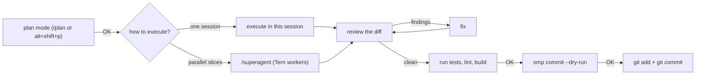

# omp development workflow: step by step

How to drive omp (`omp`, aka "Oh My Pi") through the plan → execute → review →
test → commit flow from a terminal. omp has its own built-in plan mode and
subagents; the only workflow slash command this repo adds to omp is
**`/superagent`**, which runs parallel omp workers in Tern
tabs. The other steps use omp's own features, not repo prompts.



Each arrow labelled `OK` is a gate: stop and read before replying. `omp commit`
commits immediately unless you pass `--dry-run`, so preview first (see
[Step 5](#step-5-commit)). For the Herdr-based flows with `/plan`, `/execute`, `/review` and friends,
see [pi-workflow-guide.md](pi-workflow-guide.md) and
[claude-workflow-guide.md](claude-workflow-guide.md).

Features named here: plan mode (`/plan` or `alt+shift+p`, both in-session),
and, from `omp --help`, `--plan-yolo` (auto-approves the plan, so it skips your
gate; avoid it for anything you want to review first), `omp commit`, and
`/profile` from the
[omp-model-profiles](https://github.com/rezhajulio/omp-model-profiles) plugin
(see [model-profiles.md](model-profiles.md)).

## Two kinds of helpers

| Helper | What it is | Where you see it | Use it for |
|---|---|---|---|
| **omp subagent** (task tool) | A child session inside the same omp process | Inline in the chat | Read-only exploration and short lookups while you plan or execute |
| **Tern worker** (`/superagent`) | A full interactive omp session in its own Tern tab, in an `sa-<RUN_ID>` session; inherits your settings and active `/profile` | Tern tab bar, one tab per worker | Parallel implementation slices that own disjoint files |
| **You** | — | — | Every gate, every approval dialog, every question a worker raises |

Subagents are for read-only lookups. Tern workers only run when you ask for
parallel work. Neither decides anything that needs your approval.

## Step 0: once per machine

`setup.sh` links `omp/commands` to `~/.omp/agent/commands` (so `/superagent`
exists) and `omp/skills` to `~/.omp/agent/skills` (which carries the
`tern-delegate` skill that `/superagent` loads). To check it took:

```bash
ls -l ~/.omp/agent/commands     # superagent.md
ls ~/.omp/agent/skills          # ... tern-delegate ...
tern --version                  # 0.9.x
```

Restart omp after the first setup run; it reads commands at startup.

omp must be started **inside a Tern pane**. Tern sets `$TERN_PANE` in every
pane; `/superagent` refuses to run without it.

```bash
cd ~/Artifacts/labs/src/<project>
omp                              # in a Tern pane
```

## Step 1: plan

Use omp's built-in plan mode: type `/plan [prompt]` or press `alt+shift+p`
in the session. The agent reads the repo read-only and ends with a plan.
Reply `OK` (or ask for changes). For a big plan, ask it to list **files per
step**; that decides whether the work can be parallelized.

## Step 2: choose how to execute

| Situation | Do |
|---|---|
| Small change, or steps that touch the same files | Approve the plan and let omp implement it in this session |
| Two or more steps that touch **different** files and can run at the same time | `/superagent <the approved plan>` |

## Step 3a: execute in this session

Approve the plan and omp implements it, test-first for behavior changes. It
does not commit. Next: [Step 4](#step-4-review-fix-and-test).

## Step 3b: `/superagent` (parallel Tern workers)

```text
/superagent the approved plan above
```

1. **GATE.** If no plan was explicitly approved in this conversation,
   `/superagent` prints the slice table and stops; reply `OK`.

   ```text
   | Worker | Owned files              | Goal             | Validation         |
   |--------|--------------------------|------------------|--------------------|
   | 1      | src/server/health.ts ... | /health endpoint | npm test -- health |
   | 2      | src/ui/StatusBadge.tsx … | status badge     | npm test -- Badge  |
   ```

   Check that no file appears in two rows and that each validation command is
   real. There is no Role column: omp has no roles, so workers inherit your
   settings and the active `/profile`. A Model column appears only if you
   named a model in the request (`… workers on <provider/id>`), which starts
   workers with `omp --model <provider/id>`.
2. **Workers start.** The worker count is a ceiling: `min(your N, number of
   disjoint slices)`, default 6, never more than 12. A new Tern session
   `sa-<RUN_ID>` appears with one tab per worker, named `sa-<RUN_ID>-1`,
   `sa-<RUN_ID>-2`, …. Your focus stays on the orchestrator. Each worker runs
   `env SUPERAGENT_RUN=<RUN_ID> SUPERAGENT_WORKER=1 omp` and receives its
   brief as a pasted prompt.
3. **Run directory.** Files live in `${TMPDIR:-/tmp}/superagent/<RUN_ID>`
   (`RUN_ID` is 4 hex characters, fresh per run):

   | File | Purpose |
   |---|---|
   | `<name>.brief.md` | The worker's task |
   | `<name>.result.md` | Written by the worker when done; the completion signal |
   | `<name>.answer.md` | Your answer to a blocked worker (see below) |
   | `<name>.block` | The worker's Tern block id |
   | `<name>.pid` | omp's process id, recorded at start; the wait loop checks it to detect a worker that exited |
   | `<name>.wait.status` | Outcome of the wait: `result`, `exited`, or `timeout` |
   | `baseline.tree` | Snapshot of the tree before the run, to detect changes outside owned files |

4. **Wait.** Tern has no agent state, so the orchestrator polls for each
   `<name>.result.md` (up to 3500 s per worker) and checks with `tern process`
   that omp is still running. To look at a worker, open its tab in the
   `sa-<RUN_ID>` session. Don't type into a worker while it runs.
5. **Verify.** When all results exist, the orchestrator checks that only owned
   files changed, re-runs every worker's validation itself, and prints:

   ```text
   | Worker       | Tab          | Status | Changed files | Validation |
   ```

6. **Cleanup.** If every worker finished, it closes the worker tabs
   (`tern close`) and removes the session (`tern kill session`). Otherwise it
   keeps `sa-<RUN_ID>` open and prints the session and worker names. Briefs and
   results stay in the run directory. It never commits and ends at review.

Next: [Step 4](#step-4-review-fix-and-test).

## Blocked workers

A worker is blocked when it waits at a question or an approval dialog. Tern
cannot tell blocked from busy, so a worker stuck on a prompt just looks busy
until the poll times out. If a worker takes suspiciously long, glance at the
tabs.

- **A decision the worker may not take.** It writes `status: blocked` in its
  result with a question. The orchestrator relays it; answer in the
  orchestrator chat. The answer is written to `<name>.answer.md` and pasted
  to the worker, which continues.
- **An approval or trust dialog.** Answer it yourself in that worker's tab:
  `tern focus <block>` (the block id is in `<name>.block`). The orchestrator
  never answers dialogs. Then tell it to continue.

## Step 4: review, fix and test

These steps use omp itself; the repo adds no commands for them.

1. **Review.** Ask omp to review the diff against the plan, or use a subagent.
   Read-only. Blocking findings should be separated from suggestions.
2. **Fix.** Tell it which findings to fix and which to skip. Run review → fix
   at most twice; if blocking findings remain, decide yourself.
3. **Test.** Ask it to run the project's real checks: tests, lint, build, and
   a smoke check. End-to-end tests belong here, not inside a single worker's
   slice. Read the output.

## Step 5: commit

```bash
omp commit --dry-run --no-changelog    # preview only
```

`omp commit` without `--dry-run` commits right away, and without
`--no-changelog` it also edits changelog files. So preview first: the dry run
generates a commit message from the diff without committing. Read the message
and the file list. Only after your OK, stage the exact files and commit with
the previewed message:

```bash
git add <file> <file>
git commit -m "<previewed message>"
```

Use `omp commit --no-changelog` instead only when every change in the tree
belongs in the commit; it writes a fresh message rather than reusing the
preview. Never add `--push` without asking. Workers and the orchestrator never
commit.

## Tern vs Herdr

| | Herdr (pi, Claude Code) | Tern (omp) |
|---|---|---|
| Completion | Agent state (`idle`, `blocked`, `done`) | A `<name>.result.md` file appears |
| Approval prompts | Reported as `blocked` | Look busy until the timeout; glance at the tabs |
| Reading a worker | `herdr agent read` | `tern capture <block> --surfaces`; omp draws into a Tern surface, so plain `tern capture` returns empty text. Even with `--surfaces` it shows only the message history, never the input box, menus, or dialogs, so dialogs are visible only in the tab itself |
| Outside the multiplexer | Herdr commands refuse (`HERDR_ENV` unset) | `/superagent` refuses: `Start omp inside Tern (TERN_PANE is not set); /superagent for omp needs Tern.` No Herdr fallback |
| Who uses it | pi and Claude Code `/superagent` | omp `/superagent` only; pi and Claude still use Herdr |

## Troubleshooting

| Symptom | Cause / fix |
|---|---|
| `/superagent` is missing in omp | The link is missing (`ls -l ~/.omp/agent/commands`; rerun `setup.sh`) or omp wasn't restarted since it was linked |
| `Start omp inside Tern (TERN_PANE is not set); /superagent for omp needs Tern.` | You started omp outside Tern. Open a Tern pane and run `omp` there |
| `tern capture <block>` prints nothing | Use `tern capture <block> --surfaces` (add `--scrollback` for more history) |
| A worker timed out | It may be waiting at an approval dialog. Run `tern focus <block>`, answer it, then tell the orchestrator to continue; otherwise read its tab and result in the run directory |
| A leftover `sa-*` session | A worker didn't finish, or cleanup was interrupted. `tern ls` shows it; after reading any results, remove it with `tern kill session <id>`. Only remove sessions from your own runs |
| Orchestrator reports a path changed outside owned files | A worker overstepped. Review that file's diff before accepting |
